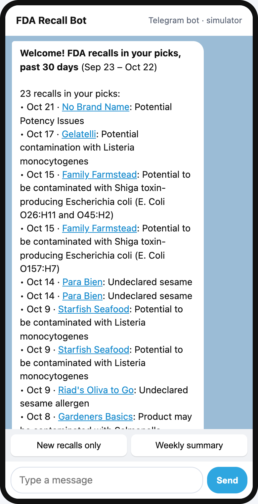
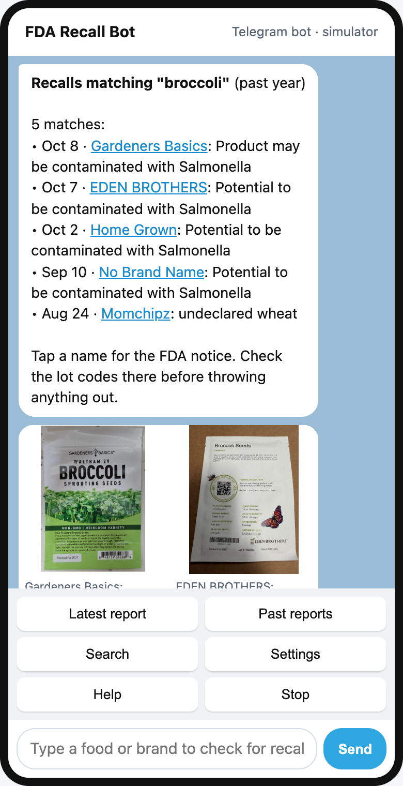
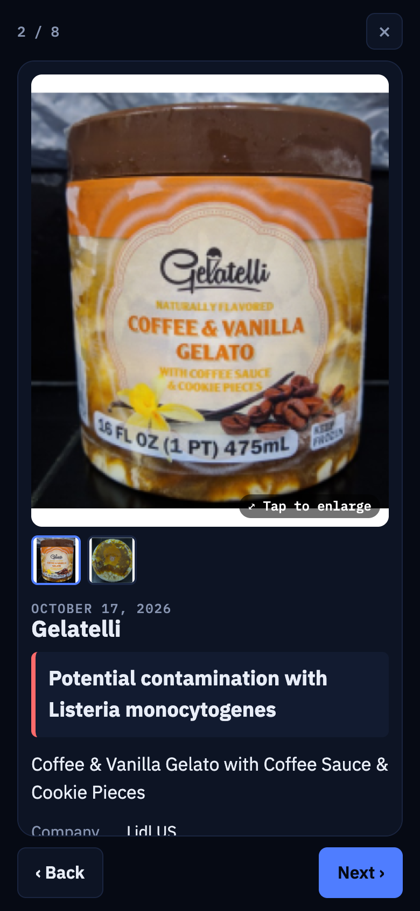
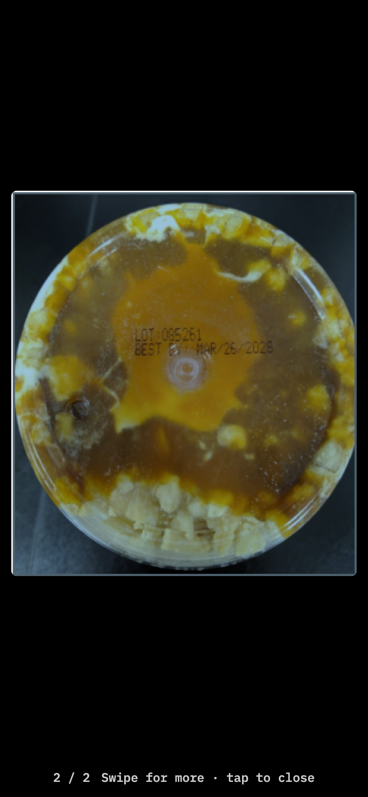
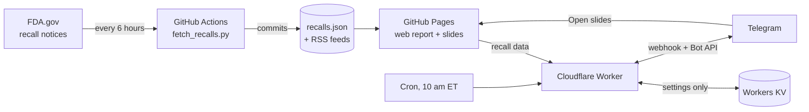

# FDA Recall Bot

A Telegram bot that tells you about FDA recalls for the things you care about (groceries, pet food, supplements, baby food, cosmetics, or drugs and devices) with the product photos FDA publishes. Get new recalls as they're posted or a weekly summary, browse any past week or month, or type any food or brand to check it.

**Try it:** [open the bot in Telegram](https://t.me/FDA_Recall_Bot) · [web report](https://el9995.github.io/FDA-Recall-Bot/) · [bot simulator](https://el9995.github.io/FDA-Recall-Bot/bot/sim.html) (the full conversation in your browser, no Telegram needed)

| Welcome report | Search | Slides | Full-screen photo |
|---|---|---|---|
|  |  |  |  |

## What it does

- **Signup in three taps:** pick categories, get a welcome report of the past 30 days, then choose **New recalls only** (a message only when FDA posts something new in your picks, checked every morning) or **Weekly summary** (every Monday).
- **Short reports:** every recall linked to its FDA notice, an album of FDA's product photos, and an **Open slides** button that opens the full deck inside Telegram as a Mini App.
- **Photo first:** people recognize the package before they read the reason, so each slide leads with the photo. Tap it for full screen and swipe to the next photo, which is often the lot code.
- **Past reports and search:** any of the last 8 weeks or 12 months, or type any food or brand to search every recall from the past year. Recalls FDA has closed are marked "closed by FDA", since a product already at home can still be affected.
- **Web report:** the same data as a site with daily, weekly and monthly views, category filters, slides, and an RSS feed per FDA product type.

## How it works

1. **Collect:** a Python script (standard library only) runs in GitHub Actions every 6 hours. It reads FDA's recall table and each new notice page for photos, waits 2 seconds between requests as FDA's robots.txt asks, and commits `data/recalls.json` and the RSS feeds. Each record keeps its source link, retrieval time and FDA status; photos are linked from FDA.gov, not copied.
2. **Publish:** the same workflow deploys the web report and slides to GitHub Pages.
3. **Talk:** a Cloudflare Worker receives Telegram messages through a webhook, reads the recall data from Pages, and replies. A daily cron sends the scheduled reports. Workers KV stores each subscriber's chat ID and settings, nothing else.

The bot logic (`bot/core.js`) is pure functions with no I/O, so the Worker and the browser simulator run the exact same code.

## Design decisions

- **No AI in the product.** Matching, search and replies are plain code, and reports show FDA's own wording, never rewritten or summarized. Nothing can be made up, and it can't drift.
- **Free to run, by design.** Everything fits free tiers (GitHub Actions and Pages, Cloudflare Workers and KV, Telegram). KV writes (1,000 a day on the free plan) are the tight limit, so the Worker writes only when someone's settings change or a scheduled report goes out; browsing and searching cost none.
- **Private by default.** The bot stores a Telegram chat ID, how often you want reports, and your picks. /stop or blocking the bot deletes them.
- **One secret to manage.** The webhook secret Telegram sends back is derived from the bot token, so the Worker and the deploy workflow compute the same value and nobody handles a second secret. Calls without it get a 401.
- **Never a stale Mini App.** Telegram's in-app browser caches aggressively, so each deploy stamps its commit on script and style links.
- **Hands-off deploys.** Pushing to `bot/` deploys the Worker and registers the webhook, command menu and description with Telegram.

## Run your own

Setup takes about 15 minutes, with free accounts only: see [`bot/SETUP.md`](bot/SETUP.md). To collect the data locally, run `python3 scripts/fetch_recalls.py`. To preview the site and the simulator, serve the folder with any local web server (`python3 -m http.server`).

## How it was made

This project was **built with AI under my direction.** Claude (Anthropic's AI coding assistant) wrote the code. I set the product direction, chose the data sources, and made the privacy, cost and accuracy calls: the bot stores only a chat ID and settings, runs at no cost, and never rewords FDA's facts.

> Not affiliated with FDA. Always confirm at [FDA.gov](https://www.fda.gov/safety/recalls-market-withdrawals-safety-alerts). Most meat, poultry and egg recalls come from USDA ([FSIS.usda.gov](https://www.fsis.usda.gov/recalls)) and aren't covered here.
